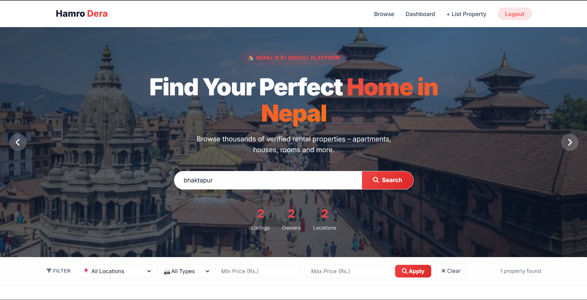
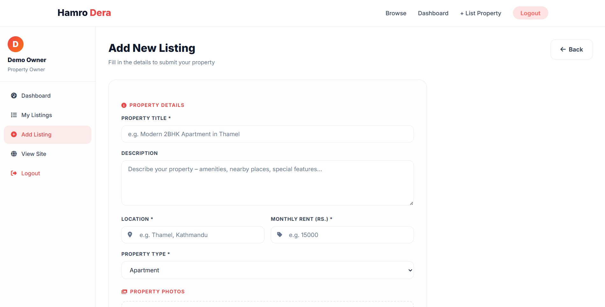
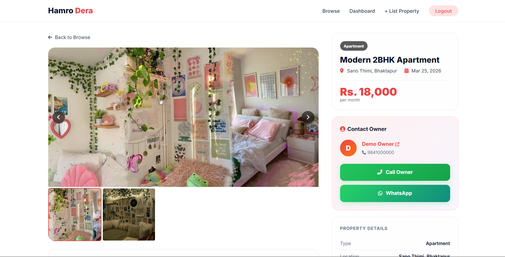
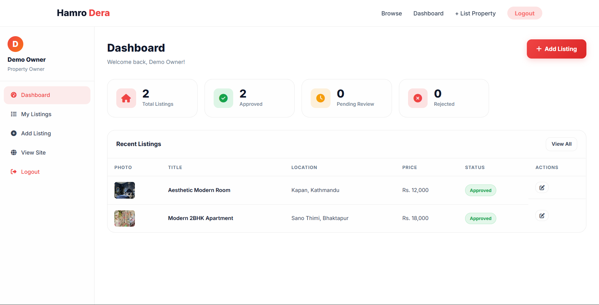

# 🏠 Hamro Dera

Hamro Dera is a web-based real estate rental platform that allows users to find suitable rooms and properties in real-time without the involvement of brokers or middlemen. The platform connects property owners directly with tenants, ensuring transparency, ease of access, and efficient communication.

---

## 🚀 Features

### 👤 User (Guest)
- Browse rental listings without login
- View detailed property information
- Search and filter by location, price, and type
- Contact owner directly via phone or WhatsApp

### 🏠 Owner
- Register and login securely
- Add, edit, and delete property listings
- Upload multiple images for listings
- Track listing status (Pending / Approved / Rejected)
- Password reset using security questions

### 🧑‍💼 Admin
- Manage owner accounts (approve, edit, delete)
- Approve or reject property listings
- Monitor overall platform activity
- Dashboard with system statistics

---

## 🧩 System Workflow

1. Owner registers and waits for admin approval  
2. Approved owner adds property listings  
3. Admin reviews and approves listings  
4. Users browse and contact owners directly  

---

## 🛠️ Tech Stack

- Frontend: HTML, CSS, JavaScript  
- Backend: PHP / Node.js  
- Database: MySQL / MongoDB  
- Tools: Git, GitHub  

## 📸 Screenshots

### 🏠 Homepage

### 🔍 Listings Page

### 📄 Property Details

### 🧑‍💼 Admin Dashboard

---

## 📂 Project Members
- Dipesh Bham
- Himal Ghatani
- Roshan Katwal
- Sujan Pathak
